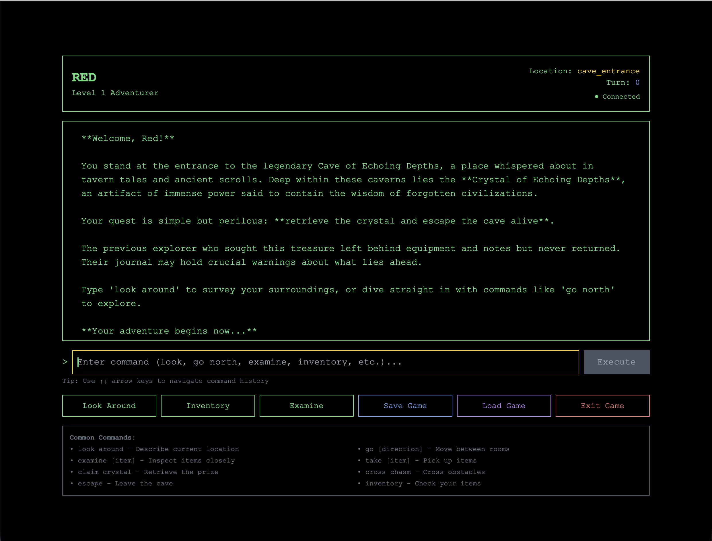
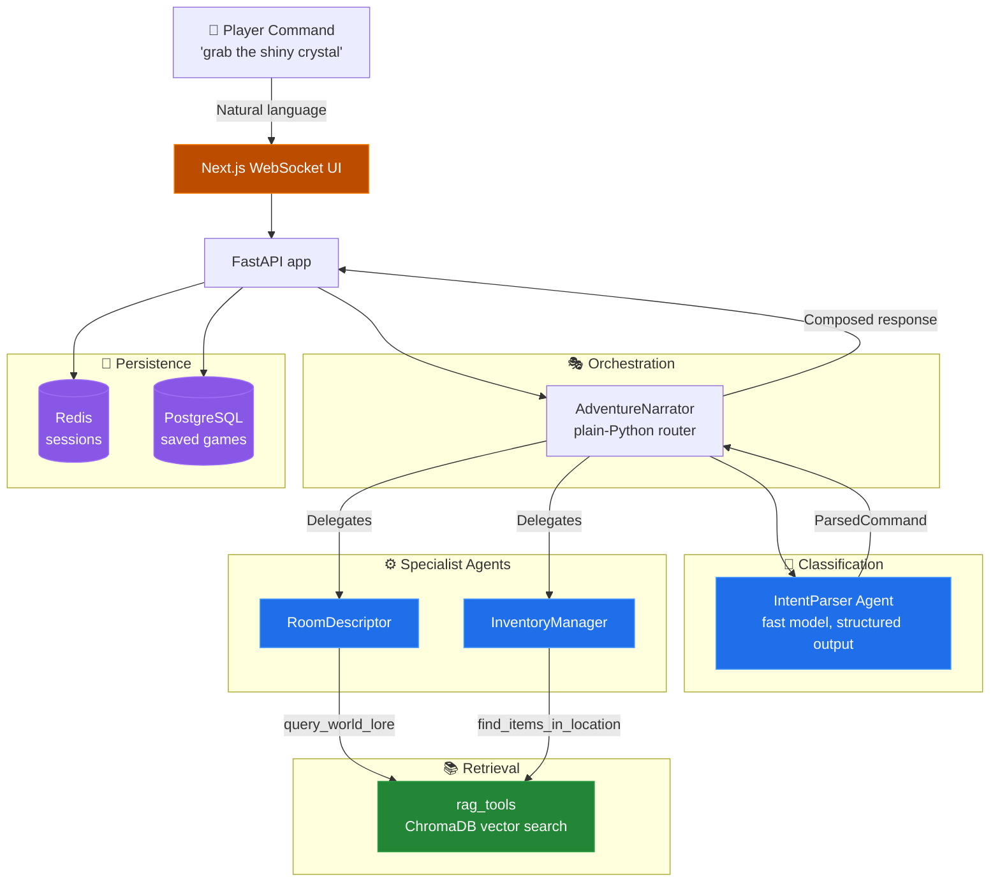

# Multi-Agent AI Text Adventure

> A demonstration of agentic AI patterns using PydanticAI



[]() []() []() [](LICENSE)

## Overview

This project demonstrates **agentic AI architecture patterns** using the [PydanticAI](https://ai.pydantic.dev) framework. Rather than building yet another chatbot, it shows how AI agents and ordinary code can work together in a system with real state, through the medium of a text-based adventure game.

**Why a text adventure?** Games provide:

- ✅ Clear success criteria (did the AI understand the command?)
- ✅ An engaging way to demonstrate AI capabilities
- ✅ Complex state management showing real-world patterns
- ✅ Natural language processing challenges
- ✅ Multi-turn play with saved state

**The real value** is in the AI architecture patterns demonstrated, not the game itself.

## What This Demonstrates

| Pattern | Implementation | PydanticAI concept | Location |
| --- | --- | --- | --- |
| **Classification** | Natural-language commands become structured intents | Agent with a structured `output_type` | [`intent_parser.py`](backend/app/agents/intent_parser.py) |
| **Orchestration** | A plain-Python orchestrator routes each parsed command to handlers and specialist agents. It is not itself an LLM agent, so game rules stay deterministic | Code-driven delegation around agents | [`adventure_narrator.py`](backend/app/agents/adventure_narrator.py) |
| **Specialist agents** | Room descriptions and inventory handled by separate agents | Multiple `Agent` instances with typed `RunContext` dependencies | [`room_descriptor.py`](backend/app/agents/room_descriptor.py), [`inventory_manager.py`](backend/app/agents/inventory_manager.py) |
| **Tool calling** | Specialists register tools the model can call | `tools=[...]` on `Agent` | see the tools table below |
| **RAG (retrieval)** | World lore retrieved from a ChromaDB vector store | Retrieval functions called by the specialist agents | [`rag_tools.py`](backend/app/tools/rag_tools.py) |
| **Session state** | Redis for live sessions, PostgreSQL for save/load | FastAPI layer | [`main.py`](backend/app/main.py) |
| **Error handling** | If an agent call fails, the orchestrator returns a fallback narrative instead of crashing | Try/except with fallback text | [`adventure_narrator.py`](backend/app/agents/adventure_narrator.py) |

## Architecture & Components

### System Diagram



### Components

- **Frontend**: Next.js (React, TypeScript) command-line style UI with a WebSocket connection for live updates
- **Backend**: FastAPI server: game sessions, save/load, and the command pipeline
- **Agents**: typed PydanticAI agents (IntentParser, RoomDescriptor, InventoryManager)
- **Orchestrator**: `AdventureNarrator`, ordinary Python that routes commands and composes responses
- **RAG**: ChromaDB vector store seeded from the Markdown world content (rooms, items, lore)
- **State**: Redis for live sessions; PostgreSQL (SQLAlchemy and Alembic) for saved games
- **Content**: Markdown files in `backend/app/world_data/`

### Agents

| Component | Kind | Purpose | Tools registered on the agent |
| --- | --- | --- | --- |
| **IntentParser** | PydanticAI agent | Classifies a command into a structured intent | none (pure classification) |
| **AdventureNarrator** | Plain Python class | Routes by command type, calls specialists, composes the response | n/a |
| **RoomDescriptor** | PydanticAI agent | Environment descriptions, using retrieved lore | `get_room_features`, `check_room_connections` |
| **InventoryManager** | PydanticAI agent | Item pickup, drop, examine, use | `check_item_availability`, `validate_inventory_space`, `get_item_properties` |

Retrieval functions in [`rag_tools.py`](backend/app/tools/rag_tools.py) (`query_world_lore`, `get_room_description`, `find_items_in_location`, `get_environmental_details`) are called from the specialist agents' code.

## 🚀 Quick Start

### Prerequisites

- Docker and Docker Compose
- Git
- An LLM provider key (OpenAI by default, or Google Vertex AI)

### Setup

1. **Clone the repository:**

   ```bash
   git clone https://github.com/jasonbgarland/pydantic_ai_demo.git
   cd pydantic_ai_demo
   ```

2. **Configure environment:**

   ```bash
   cp .env.example .env
   # Edit .env and add your LLM provider configuration
   ```

   **Option A: OpenAI (default)**

   ```bash
   # .env
   LLM_PROVIDER=openai
   OPENAI_API_KEY=sk-your-key-here
   OPENAI_MODEL=gpt-4o-mini  # Default model
   OPENAI_MODEL_FAST=gpt-4o-mini  # For quick tasks (intent parsing)
   OPENAI_MODEL_POWERFUL=gpt-4o  # For complex reasoning (optional)
   ```

   **Option B: Google Vertex AI with Gemini**

   ```bash
   # .env
   LLM_PROVIDER=google-vertex
   GOOGLE_PROJECT=your-gcp-project-id
   GOOGLE_LOCATION=us-central1  # GCP region
   # Authentication: use one of these methods:
   # 1. API Key (simplest)
   GOOGLE_API_KEY=your-api-key
   # 2. Application Default Credentials (gcloud CLI)
   #    Run: gcloud auth application-default login

   # Model configuration (optional, defaults to Gemini Flash)
   GOOGLE_MODEL=gemini-2.0-flash-exp  # Default model
   GOOGLE_MODEL_FAST=gemini-2.0-flash-exp  # For quick tasks
   GOOGLE_MODEL_POWERFUL=gemini-2.0-pro-exp  # For complex reasoning
   ```

   **Setting up Google Vertex AI:**
   1. Create a GCP project at [console.cloud.google.com](https://console.cloud.google.com)
   2. Enable the Vertex AI API
   3. Choose an authentication method:
      - **API Key**: create one at [Vertex AI API Keys](https://cloud.google.com/vertex-ai/generative-ai/docs/start/api-keys)
      - **gcloud CLI**: install the [gcloud CLI](https://cloud.google.com/sdk/gcloud) and run:
        ```bash
        gcloud auth application-default login
        gcloud config set project your-gcp-project-id
        ```
   4. Install Google dependencies (already pinned in `backend/requirements.txt` as `pydantic-ai-slim[google]`)

3. **Set up the vector database (one time):**

   ```bash
   # Generates embeddings and creates the vector database.
   # Requires an OpenAI API key. Only run again when the world content changes.
   ./scripts/setup-vectors.sh
   ```

4. **Launch the application:**

   ```bash
   docker-compose up
   ```

5. **Verify:**

   ```bash
   docker-compose ps
   curl http://localhost:8001/health
   ```

The application will be available at:

- **Frontend**: http://localhost:3000
- **Backend API**: http://localhost:8001 (FastAPI docs at `/docs`)
- **ChromaDB**: http://localhost:8000

## 🧠 Vector Database Strategy

Embeddings are **generated once and mounted** into the ChromaDB container.

- **Cost efficient**: embeddings are generated once and reused across environments
- **Fast startup**: no embedding API calls when containers launch
- **Git friendly**: the Markdown world content is versioned; the vector binaries are gitignored

How it works:

1. `./scripts/setup-vectors.sh` generates the embeddings locally
2. Docker mounts `./chroma_data` into the ChromaDB container
3. The vector data persists between container restarts

```
├── backend/app/world_data/     # world content (versioned)
│   ├── rooms/*.md
│   └── items/*.md
├── chroma_data/                # vector files (gitignored)
└── scripts/setup-vectors.sh    # setup script (versioned)
```

## 🧪 Testing

230 tests in total. The backend uses Python's `unittest`; the frontend uses Jest.

| Suite | Tests | Covers | Needs an LLM key? |
| --- | --- | --- | --- |
| Backend unit | 58 | database models, mechanics, room descriptor, sessions (mocked, fast) | No |
| Backend integration | 80 | game flow, save/load, WebSocket, items, examination, collapse, edge cases, intent parser, sessions, state consistency | Yes |
| Backend extras | 41 | game-flow scenarios, narrator tools, name utils, command pipeline | Scenarios and pipeline: yes |
| Frontend (Jest) | 51 | save and load modals, WebSocket hook, save/load API client | No |

`./scripts/test-all.sh` runs the backend unit and integration suites. The extras are not part of that script. A full run exits 0 with 58 unit and 80 integration tests passing; 4 integration tests mark themselves skipped. The Jest suite and the extras were not part of that run.

```bash
./scripts/dev.sh              # list all commands
./scripts/dev.sh test         # all tests
./scripts/dev.sh test-unit    # unit tests only (mocked)
./scripts/dev.sh test-int     # integration tests (needs running services)
./scripts/dev.sh lint         # pylint
```

Integration tests make real LLM calls, so they cost API credits. They are off by default and enabled with `RUN_INTEGRATION_TESTS=1`:

```bash
docker-compose exec -e RUN_INTEGRATION_TESTS=1 backend python -m unittest discover -v
```

## 🎯 API Endpoints

**Health**
- `GET /` status and service connectivity
- `GET /health` simple health check

**Game**
- `POST /character/create` create a character
- `POST /game/start` start a session
- `POST /game/{id}/command` send a command
- `GET /game/{id}/state` current session state
- `WS /ws/game/{id}` live updates over WebSocket

**Save / load**
- `POST /game/{id}/save`, `POST /game/{id}/load`, `GET /game/saves`, `DELETE /game/{id}/save`

## 🔧 Development

### Project Structure

```
├── backend/
│   ├── app/
│   │   ├── main.py          # FastAPI app and endpoints
│   │   ├── agents/          # PydanticAI agents and the orchestrator
│   │   ├── tools/           # RAG retrieval functions
│   │   ├── models/          # SQLAlchemy models
│   │   ├── mechanics.py     # game rules
│   │   └── world_data/      # Markdown world content
│   ├── migrations/          # Alembic
│   └── tests/
├── frontend/                # Next.js app (with Jest tests)
├── docs/                    # game flow and mechanics notes
├── scripts/                 # dev, setup, test, and lint helpers
└── docker-compose.yml
```

### Location name handling

Location names are normalized automatically. Display form ("Cave Entrance") and storage form (`cave_entrance`) are interchangeable in the retrieval functions. Known locations are defined in `backend/app/utils/location_utils.py`: Cave Entrance, Hidden Alcove, Yawning Chasm, Crystal Treasury, Collapsed Passage.

### Environment variables

Key variables in `.env`: `LLM_PROVIDER`, `OPENAI_API_KEY` (or the Google settings above), `DATABASE_URL`, `REDIS_URL`, `CHROMA_URL`. See `.env.example`.

## 🐳 Docker Services

| Service | Port | Purpose |
| --- | --- | --- |
| frontend | 3000 | Next.js UI |
| backend | 8001 | FastAPI API |
| postgres | 5432 | Saved games |
| redis | 6379 | Session state |
| chroma | 8000 | Vector database |

## 📚 Tech Stack

- **Backend**: Python 3.11, FastAPI, PydanticAI, SQLAlchemy, Alembic, Redis, PostgreSQL
- **Frontend**: Next.js, React, TypeScript, Jest
- **AI/ML**: PydanticAI, ChromaDB, OpenAI or Google Vertex AI (Gemini)
- **Infrastructure**: Docker Compose

## 📝 License

[MIT](LICENSE)
